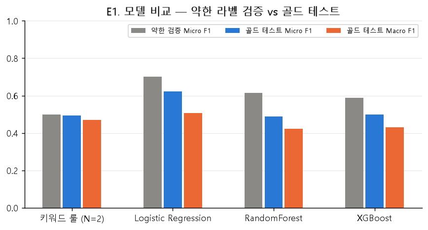
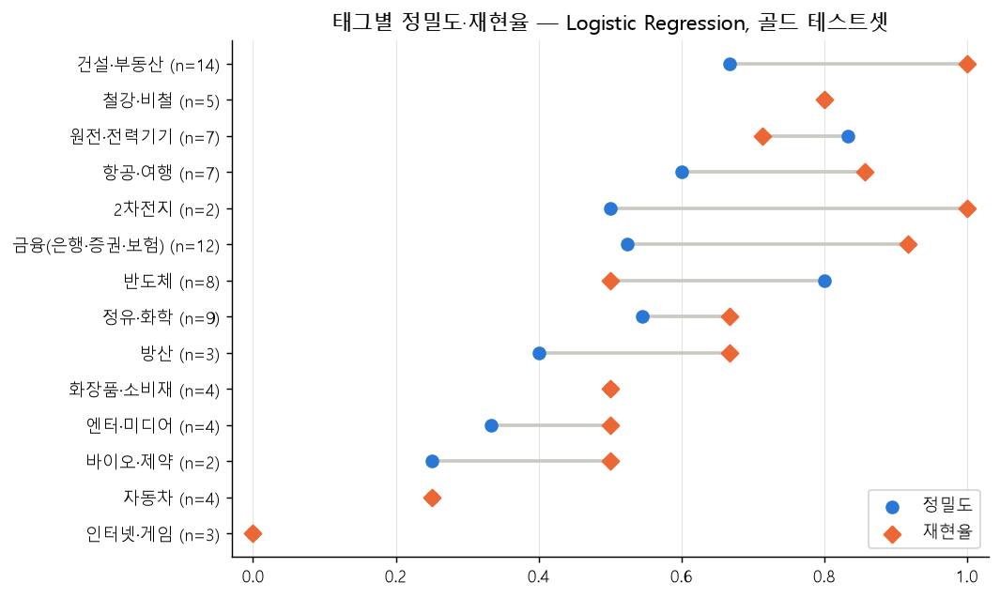
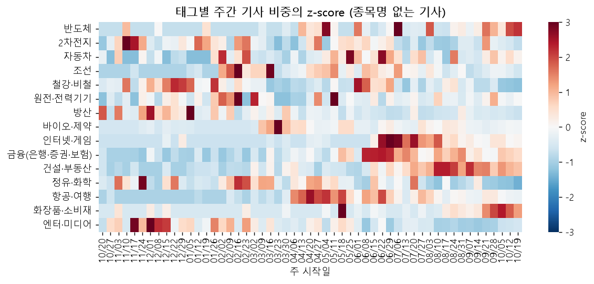

# 경제 뉴스 산업·테마 자동 태거 (news-theme-tagger)

종목명이 나오지 않는 경제 뉴스(정책·거시·산업 동향)를 읽고 **어떤 산업·테마에 영향을 주는지** 15개 태그로 붙이는
다중 라벨 분류 모델입니다. 정답 라벨은 사람이 달지 않고 **"종목 뉴스 → 종목 → 테마" 연결에서 자동으로 빌려 옵니다**
(약한 지도학습). 학습은 종목명이 있는 기사의 종목명을 가린 채로 하고, 평가는 종목명이 없는 기사로 합니다.

> "美 관세 25% 부과 검토", "HBM 공급 부족 지속" 같은 기사는 종목명이 없어서 사전 매칭이나 종목 뉴스로는 잡히지 않지만,
> 투자자에게 영향이 큰 건 오히려 이런 기사입니다.

### 결과 요약

| | 골드 테스트 Micro F1 (200건) | Precision@1 | 비고 |
|---|---|---|---|
| 키워드 룰 (베이스라인) | 0.492 | 0.760 | 학습 없음 |
| **Logistic Regression (최종)** | **0.622** [95% CI 0.536~0.698] | **0.873** ※ | TF-IDF 단어·문자 + 키워드 사전 |
| RandomForest / XGBoost | 0.489 / 0.500 | 0.785 / 0.823 | LR보다 낮을 확률 99.9% / 99.4% |

※ Precision@1: 정답 태그가 1개 이상인 기사(79건)에서 확률 1위 태그가 정답에 들어 있는 비율. '관련 없음' 기사는 계산에서 빠집니다.

- **산업 구분은 되지만, 관련 없는 기사를 걸러 내는 건 아직 약합니다.** 정답 태그가 있는 기사에서는 1위 태그가 87% 맞지만,
  기사의 60%가 '관련 없음'이라 실제로 붙인 태그 중 맞는 비율은 55~60%입니다 → 자동 알림보다는 **사람이 검토하는 보조 도구**로
  먼저 쓰고, '관련 없음' 기사를 학습시키는 것이 다음 과제입니다(7절 제언).
- **종목명 마스킹이 핵심**: 가리지 않으면 약한 검증 점수는 0.93까지 오르지만 실제 일반 기사(골드)에서는 오히려 떨어집니다(0.622 → 0.584).
- 7.06만 건 적용 결과, 태그 급증 주간이 약가 인하·화장품 무역흑자·원전 수출체계 개편 같은 실제 이슈와 맞았습니다.

---

## 1. 문제 정의

| 항목 | 내용 |
|---|---|
| 과제 | 다중 라벨 텍스트 분류 (One-vs-Rest), 약한 지도학습 |
| 입력 | 기사 제목 + 요약(본문 앞 1~2문장) |
| 출력 | 15개 태그 중 0개 이상 (어떤 태그도 임계값을 넘지 않으면 "관련 테마 없음") |
| 학습 데이터 | 대표 종목 뉴스 — 종목명이 제목에 있는 기사만, 전체 상장사명을 `[기업]`으로 마스킹 |
| 평가 데이터 | 종목명이 하나도 없는 경제 기사 300건을 라벨링한 골드셋 (검증 100 / 테스트 200). 라벨은 AI(Claude)가 기사를 읽고 달았으며 사람 검수 전입니다 |
| 사용 시나리오 | 보유 종목 테마 관련 정책·산업 기사 알림, 급등 종목 화면의 "관련 테마 뉴스" |

**태그(15개)**: 반도체 · 2차전지 · 자동차 · 조선 · 철강·비철 · 원전·전력기기 · 방산 · 바이오·제약 · 인터넷·게임 ·
금융(은행·증권·보험) · 건설·부동산 · 정유·화학 · 항공·여행 · 화장품·소비재 · 엔터·미디어 — 태그마다 사업이 그 산업에
집중된 대표 종목 8~14개(총 161개, `data/raw/tag_map.csv`). 삼성전자·LG·SK 같은 다산업 대기업은 노이즈 때문에 제외했습니다.

## 2. 파이프라인

```
[학습]  대표 종목 161개 ─ 네이버 검색 API ─▶ 종목 뉴스 41.9만 행 ─ 제목에 종목명 있는 기사만 · URL 병합(태그 합집합)
        ─▶ 정제 · 전 상장사명 마스킹 · 형태소 · 중복 제거 · 태그별 상한 ─▶ 학습 2.87만 / 약한 검증 7.2천 (시간순 80:20)
        ─▶ TF-IDF(단어·문자) + 키워드 사전 ─▶ 키워드 룰 / LR / RF / XGBoost  (TimeSeriesSplit 튜닝)

[적용]  거시·산업 키워드 84개 ─ 네이버 검색 API ─▶ 경제 뉴스 16.7만 행 ─ 기업명이 하나도 없는 기사만 ─▶ 7.0만 건
        ─▶ 무작위 300건 라벨링(골드셋) ─▶ 임계값(검증 100) · 최종 평가(테스트 200) ─▶ 전체 태깅 · 주별 추이 · 태그 지수 비교
```

## 3. 실행 방법

```bash
pip install -r requirements.txt
cp .env.example .env     # NAVER API HUB 검색 API 키 입력 (아래 참고)

python scripts/collect.py d2          # 대표 종목 뉴스 수집 (약 4,200회 호출, 중단 시 이어받기)
python scripts/collect.py d3          # 경제 뉴스 수집 (약 1,700회 호출)
python scripts/build_notebooks.py     # notebooks/py/*.py → notebooks/*.ipynb 변환 후 순서대로 실행
```

- **API 키**: 네이버 검색 API는 2026년 NAVER API HUB(네이버 클라우드)로 이관됐습니다. NCP 콘솔 → NAVER API HUB에서 검색 API를
  신청하고 발급된 Client ID/Secret을 `.env`의 `NAVER_CLIENT_ID`, `NAVER_CLIENT_SECRET`에 넣습니다
  (엔드포인트 `naverapihub.apigw.ntruss.com/search/v1/news`, 헤더 `X-NCP-APIGW-API-KEY-ID` / `X-NCP-APIGW-API-KEY`).
- 노트북 원본은 `notebooks/py/*.py`(`# %%` 셀 구분)이고, 실행 결과가 담긴 `.ipynb`가 산출물입니다.
  마크다운만 고쳤을 때는 `python scripts/build_notebooks.py --md-only 02`로 재실행 없이 갱신합니다.
- 학습된 모델은 `outputs/models/*.joblib`, 그림·표는 `outputs/`에 저장됩니다. 새 기사 태깅 예시는 `05_insight` 마지막 절.

```
news-theme-tagger/
├── README.md
├── requirements.txt
├── data/
│   ├── raw/          # 수집 원본 CSV (D1 KRX 목록·tag_map, D2 종목 뉴스, D3 경제 뉴스, D5 가격·태그 지수)
│   ├── processed/    # 정제·마스킹·토큰화 완료 데이터 (pkl), 시드 키워드
│   └── gold/         # 골드셋 표본(gold_sample.csv)과 라벨(gold_labels.csv)
├── notebooks/
│   ├── 01_collect.ipynb      # D1~D3, D5 수집
│   ├── 02_eda.ipynb          # 분포, 동시 출현, 추이, 어휘 차이
│   ├── 03_preprocess.ipynb   # 정제, 마스킹, 형태소, 중복 제거, 분할, D3 필터, 골드셋 표본
│   ├── 04_modeling.ipynb     # 키워드 사전, 튜닝, E1~E5, 변수 중요도
│   ├── 05_insight.ipynb      # 골드셋 최종 평가, 혼동·오분류 분석, D3 적용 인사이트
│   └── py/                   # 노트북 원본 (.py)
├── src/
│   ├── config.py     # 태그 체계·대표 종목·약칭·그룹명·모호한 이름
│   ├── crawler.py    # 네이버 검색 API(NAVER API HUB) 수집기, KRX 목록, 가격·태그 지수
│   ├── masking.py    # 종목명 사전 생성과 마스킹
│   ├── text.py       # 정제·형태소 분석(kiwipiepy)·불용어
│   ├── dataset.py    # 약한 라벨 생성, 중복 제거, 태그별 상한, 시간순 분할, 골드셋 로딩
│   ├── features.py   # TF-IDF·키워드 사전·메타 피처
│   ├── modeling.py   # 파이프라인, 약한 검증+골드셋 동시 평가, 저장 모델 래퍼
│   ├── evaluate.py   # 다중 라벨 지표, 임계값 조정, 키워드 룰 베이스라인
│   └── viz.py        # 시각화 스타일
├── scripts/          # collect.py(수집), build_notebooks.py(노트북 빌드), nb_outputs.py
└── outputs/          # 그림(png/html), 실험 표(csv), 모델(joblib)
```

## 4. 결과

### 4-1. 모델 비교 (E1)

학습·튜닝은 약한 라벨(`TimeSeriesSplit`)로, 임계값은 골드 검증 100건으로, 최종 평가는 골드 테스트 200건으로 했습니다.

| 모델 | 약한 검증 Micro F1 | 골드 Micro F1 | 골드 Macro F1 | 골드 정밀도 | 골드 재현율 | Precision@1 |
|---|---|---|---|---|---|---|
| 키워드 룰 (N=2) | 0.500 | 0.492 | 0.469 | 0.361 | **0.774** | 0.760 |
| **Logistic Regression** | **0.701** | **0.622** | **0.507** | **0.551** | 0.714 | **0.873** |
| RandomForest | 0.614 | 0.489 | 0.423 | 0.383 | 0.679 | 0.785 |
| XGBoost | 0.588 | 0.500 | 0.430 | 0.409 | 0.643 | 0.823 |



- 희소한 TF-IDF에서는 선형 모델이 가장 강했습니다. RF는 SVD 300차원(설명 분산 59%)으로 줄이며 정보를 잃었고,
  XGBoost는 early stopping으로 대부분 태그에서 50라운드 안에 멈췄습니다.
- 약한 검증 → 골드 하락폭은 LR 기준 −0.08입니다. 키워드 룰은 두 점수가 거의 같습니다(0.50 / 0.49).
- 골드 테스트가 200건이라 Micro F1 95% 구간이 약 ±0.08입니다(기사 단위 부트스트랩 1,000회). LR과 RF·XGBoost의 차이는
  짝지은 차이 구간이 0을 포함하지 않지만, 아래 E2~E5의 0.01~0.05 차이는 방향만 참고해야 합니다.
- 임계값: 검증 100건으로 태그별 최적화를 하면 과적합돼서, 전 태그 공통 임계값(0.8)을 정하고 양성 5개 이상인 태그
  (건설·부동산 0.425, 정유·화학 0.95)만 따로 조정했습니다. 0.5 고정(0.595)보다 높습니다.
- RF·XGBoost 탐색은 실행 시간 때문에 RandomizedSearch 12·15회로 줄였습니다. 30회 탐색(마스커 수정 전)과 비교해 CV 점수 차이가
  RF 0.007·XGBoost 0.023으로, LR과의 차이(0.1 이상)에 비해 작아 결론은 같습니다.

### 4-2. 실험 (E2~E5, LR 기준 골드 Micro F1)

| 실험 | 비교 | 약한 검증 | 골드 Micro | 골드 Macro |
|---|---|---|---|---|
| E2 마스킹 | O / X | 0.701 / **0.933** | **0.622** / 0.584 | **0.507** / 0.434 |
| E3 피처 | 단어 / 문자 / 단어+문자 / +키워드 사전 / +메타 | 0.668 / 0.672 / 0.694 / 0.701 / 0.702 | 0.595 / 0.554 / 0.611 / **0.622** / 0.575 | 0.471 / 0.395 / 0.503 / **0.507** / 0.496 |
| E4 입력 | 제목만 / 제목+요약 | 0.551 / 0.701 | 0.571 / **0.622** | 0.479 / 0.507 |
| E5 라벨 필터 | 제목 필터 O / X | 0.701 / 0.560 | 0.622 / **0.629** | 0.507 / 0.503 |

- **E2 마스킹**: 마스킹하지 않은 모델의 상위 피처는 전부 종목명(ISC, 한미반도체, 풍산 …)이고, 종목명을 가린 검증셋에서는
  0.44로 떨어집니다. **약한 검증 점수만 보면 마스킹 없는 모델이 훨씬 좋아 보인다**는 점이 이 프로젝트의 방법론적 핵심입니다.
- **E3 피처**: 단어+문자 n-gram(+0.02), 키워드 사전(+0.01)은 같은 방향이지만 구간 안의 차이입니다. 언론사·길이 메타는
  오히려 −0.05로, 종목 기사 언론사 분포에서 배운 편향이 일반 기사에 옮겨 가지 않습니다.
- **E4 입력**: 요약(본문 앞 1~2문장)을 넣으면 골드 +0.05. 제목만으로는 부족합니다.
- **E5 라벨 필터**: 제목에 종목명이 없는 '지나가는 언급' 기사까지 넣으면 약한 검증은 크게 떨어지지만 골드는 +0.007(정밀도 0.55 → 0.60).
  **약한 라벨의 '정확도'와 '일반화'가 같은 방향이 아닐 수 있다**는 신호입니다.

### 4-3. 태그별 성능과 오류



- 건설·부동산(F1 0.80)·철강·비철(0.80)·원전·전력기기(0.77)·항공·여행(0.71)은 잘 맞고, 인터넷·게임(0)·자동차(0.25)·
  바이오·제약(0.33)은 어렵습니다. 태그당 양성이 0~14개라 태그별 수치는 흔들림이 큽니다.
- 정답이 없는 기사에 붙은 오탐은 금융(9건)·건설(6)·정유(5)·엔터(4) 순입니다. 금리·유가·주택·OTT 같은 단어만 나와도
  해당 산업으로 끌려갑니다(**키워드 과민**).
- 오분류 68건 중 20건을 직접 읽고 원인을 분류했습니다: 진짜 애매함 9 · 키워드 과민 5 · 도메인 차이 3 · 임계값 3.
  절반가량은 라벨 판단 자체가 갈리는 기사라 **골드셋 이중 라벨링**이 다음 과제입니다.
- 변수 중요도: LR 상위 피처는 산업 어휘의 문자 n-gram과 키워드 사전 피처가 대부분이지만, 경영자·창업자 이름(박진영 등)과
  브랜드명(메가박스)도 섞여 있습니다. 회사명을 가려도 인명·브랜드로 종목을 식별하는 길이 남아 있습니다.

## 5. 인사이트 — 종목명 없는 기사 7.06만 건 적용



- 51%에 태그가 붙어 골드셋 정답 비율(39%)보다 많습니다(과다 태깅). 산업 검색어 기사는 77%, 거시 검색어 기사는 29%가 태깅됐습니다.
- 태그 기사 비중이 급증한 주(z ≥ 2)는 실제 이슈와 맞았습니다.

  | 주 | 태그 | z | 무슨 일 |
  |---|---|---|---|
  | 2026-03-23 | 바이오·제약 | 6.5 | 제네릭 약가 40%대 인하 의결 |
  | 2026-05-18 | 화장품·소비재 | 5.2 | 화장품 무역흑자 첫 100억 달러 |
  | 2026-01-05 | 방산 | 5.1 | 국방 예산 이슈 + 구리 가격 급등(라벨 노이즈, 아래) |
  | 2026-02-16 | 조선 | 4.2 | 일본 조선업 부활 선언, LNG선 수주 |
  | 2026-05-11 | 원전·전력기기 | 3.8 | 원전수출기획위원회 신설 |

- **라벨 노이즈 실례**: 풍산(철강·비철 + 방산) 때문에 모델이 '구리 → 방산'을 배웠습니다. 2026-01-05 주 방산 급증 기사 6건 중 3건이
  구리 가격 기사였습니다. 두 산업에 걸친 종목은 태그 2개를 주기보다 학습에서 빼는 편이 낫습니다.
- **D3 필터의 한계**: 2026-02-16 주 원전·전력기기 급증(z=3.0)은 비상장사 HET(에이치이티)의 변압기 설비 투자 기사 7건이었습니다.
  상장사 사전으로 거르기 때문에 비상장사 기사는 '종목명 없는 기사'로 남습니다.
- **태그 지수와의 관계**: 태그 기사 비중 z-score와 같은 주 태그 지수 수익률의 상관은 평균 −0.01, 절대수익률과는 0.06으로
  뚜렷한 관계가 없습니다(방산 수익률 0.33, 인터넷·게임 |수익률| 0.36이 예외). 표본 53주이고 같은 사건에 동시에 반응한 것일 수
  있어 **상관관계 확인까지만** 했습니다.

## 6. 단계별로 알게 된 것

각 노트북 끝의 "이 단계에서 알게 된 것"을 요약했습니다.

- **01 수집**: 네이버 금융·뉴스 페이지는 robots.txt로 크롤링이 금지돼 공식 검색 API로 바꿨고, 그 대가로 본문 대신 요약(평균 160자)만 씁니다.
  검색 API는 정렬별로 약 1,000건만 줘서 기사가 최근(2026년 9~10월)에 몰립니다.
- **02 EDA**: 태그 동시 출현은 예상했던 산업 사슬(2차전지·자동차)보다 **같은 기업집단 계열사 동반 보도**(카카오-SM, 현대차-현대로템)가 강했습니다.
  D2 제목 상위어는 목표가·실적·주가, D3는 수출·정부·금리·환율로 어휘가 달라, 골드 점수가 약한 라벨 점수보다 낮을 것을 예상했습니다.
- **03 전처리**: 최근 12개월 · 중복 제거(약 9%) · 태그별 상한 2,500건으로 학습 2.87만 / 약한 검증 7.2천 건. 마스킹은 은어(하닉)·비상장 계열사·
  그룹 접두어 규칙까지 보강했고, 경제 기사의 32.7%가 기업명을 언급해 빼고 7.06만 건이 남았습니다.
- **04 모델링·05 평가**: 위 4~5절.

## 7. 종합 평가와 제언

### 7-1. 평가 결과가 의미하는 것

| 질문 | 답 | 근거 |
|---|---|---|
| 어떤 모델을 써야 하나? | **Logistic Regression** | 골드 Micro F1 0.622로 RF(0.489)·XGBoost(0.500)·키워드 룰(0.492)보다 높고, 부트스트랩 차이 구간이 0을 포함하지 않음. 학습 1분, 계수로 해석 가능 |
| 학습이 사전보다 나은가? | **그렇다, 주로 정밀도에서** | 키워드 룰 대비 Micro F1 +0.13, 정밀도 0.36 → 0.55. 재현율은 룰이 더 높음(0.77 vs 0.71) |
| 산업을 구분하는가? | **대체로 그렇다** | 정답 태그가 있는 기사에서 확률 1위 태그가 맞는 비율 87% |
| 기사가 관련 있는지 판단하는가? | **아직 약하다** | 정답이 '없음'인 기사(121건, 60%) 중 32%에 태그가 붙음. 그래서 붙인 태그 중 맞는 비율이 55%에 그침 |
| 약한 라벨 점수를 믿어도 되나? | **아니다** | 약한 검증 0.70 → 골드 0.62. 마스킹을 빼면 약한 검증은 0.93으로 오르지만 골드는 내려감 |
| 주가 신호로 쓸 수 있나? | **근거 없음** | 태그 기사 급증과 같은 주 태그 지수 수익률의 상관 평균 −0.01 |

**핵심은 "어느 산업인가"보다 "애초에 산업과 관련 있는 기사인가"가 더 어렵다는 것입니다.** 모델은 종목 기사로만 배워서
'산업 이야기가 아닌 기사'를 본 적이 없습니다. 금리·유가·OTT 같은 단어가 나오면 관련 없는 기사에도 태그를 붙입니다.
실제 화면처럼 확률 1위 태그를 확률 0.8 이상일 때만 보여 준다고 해 보면(골드 테스트 200건):

| 노출 기준 (1위 태그 확률) | 노출되는 기사 | 노출된 태그가 맞는 비율 | 정답 있는 기사를 맞혀 노출 | '없음' 기사에 잘못 노출 |
|---|---|---|---|---|
| ≥ 0.5 | 69% | 49% | 85% | 53% |
| ≥ 0.8 | 50% | 58% | 73% | 32% |
| ≥ 0.95 | 38% | 62% | 59% | 24% |

임계값을 올려도 노출된 태그가 맞는 비율은 60% 근처에서 더 오르지 않습니다. 확률이 높은데도 틀리는 오탐(예: 소방차 예산 → 자동차 0.92)이
많아서, **임계값 조정만으로는 해결되지 않고 '관련성' 자체를 학습시켜야** 합니다.

### 7-2. 활용 제언 — 지금 상태로 할 수 있는 것

1. **사람이 검토하는 보조 도구로 먼저 쓴다.** 노출된 태그의 약 40%가 틀리므로 투자자에게 자동 알림을 보내기에는 이릅니다.
   리서치·뉴스 큐레이션 담당자가 "이 기사, ○○ 테마 관련?" 후보를 빠르게 훑는 용도라면, 실제 관련 기사의 73~85%를 맞는 태그와 함께 후보로 올려 줍니다.
2. **자동 노출이 필요하면 성능이 확인된 태그부터 쓴다.** 골드 F1이 높은 4개 태그(건설·부동산, 철강·비철, 원전·전력기기, 항공·여행)만
   알리면 정밀도가 0.55 → 0.69로 오릅니다(재현율 0.88). 단, 이 4개는 테스트 결과를 보고 고른 것이라 새 데이터로 다시 확인해야 합니다.
3. **금융·정유·엔터 태그는 거시 기사에서 보류한다.** '없음' 기사의 오탐이 금융(9건)·정유(5)·엔터(4)에 몰려 있습니다. 거시 검색어로
   모은 기사에서는 이 세 태그를 노출하지 않는 규칙만으로도 오탐을 크게 줄일 수 있습니다.
4. **이슈 탐지(주간 급증)는 바로 쓸 만하다.** 개별 기사 태그는 틀리는 게 섞여도, 주 단위로 모으면 약가 인하·화장품 무역흑자·원전 수출체계 개편 같은
   실제 이슈가 드러났습니다. 다만 급증 주에는 원인 기사 제목을 함께 보여 줘야 합니다(방산 급증의 절반이 구리 기사였던 사례).
5. **매매 신호로는 쓰지 않는다.** 기사 급증과 태그 지수 수익률 사이에 일관된 관계가 없었습니다.

### 7-3. 개선 제언 — 우선순위 순

| 순위 | 할 일 | 기대 효과 | 이유 |
|---|---|---|---|
| 1 | **골드셋 사람 검수 + 1,000건 이상으로 확대** | 평가 신뢰도 | 지금 라벨은 AI(Claude)의 1회 판단이고, 구간이 ±0.08이라 0.05 미만 개선은 확인할 수 없음. 개선 실험 전에 먼저 해야 할 일 |
| 2 | **'관련 없음' 기사를 학습에 넣기** (2단계 분류: 관련성 → 산업) | 정밀도 | 오탐의 주 원인. D3 거시 기사에서 '없음' 판정 예시를 수백 건 확보해 음성 예시로 학습 |
| 3 | **두 산업에 걸친 종목을 학습에서 제외** (풍산·POSCO홀딩스·SK이노베이션) | 라벨 노이즈 | '구리 → 방산' 같은 잘못된 연상을 직접 확인함 |
| 4 | **인명·브랜드·비상장사 사전 보강** | 일반화 | 회사명을 가려도 경영자 이름·브랜드로 종목을 외우는 길이 남아 있음. D3 필터도 비상장사를 거르지 못함 |
| 5 | **한국어 사전학습 모델(예: KR-ELECTRA, KoBERT) 미세조정** | 성능 상한 | 트리 모델은 LR보다 0.12 낮아 더 튜닝할 가치가 작음. 문맥으로 '관련성'을 판단하려면 문장 단위 모델이 다음 후보. 1~3번을 먼저 해야 효과를 측정할 수 있음 |

## 8. 한계

- **평가 데이터**: 골드 테스트 200건(정답 태그 84개)이고, 라벨은 AI(Claude)가 달았으며 사람 검수 전입니다. 태그당 양성이 0~14개라 태그별 수치는 흔들림이 큽니다.
- **입력 정보**: robots.txt 때문에 기사 본문 대신 검색 API의 요약(1~2문장)만 씁니다.
- **시점 쏠림**: 검색 API 특성상 학습 기사가 최근 몇 주에 몰려 있어, 오래된 이슈 어휘는 덜 배웁니다.
- **탐색 축소**: RF·XGBoost는 실행 시간 때문에 하이퍼파라미터 탐색을 12·15회로 줄였습니다(결론에는 영향 없음, 4-1 참고).
- **상관 분석**: 태그 지수 비교는 53주, 동일가중 대표 종목 지수 기준이며 인과로 해석하지 않습니다.
